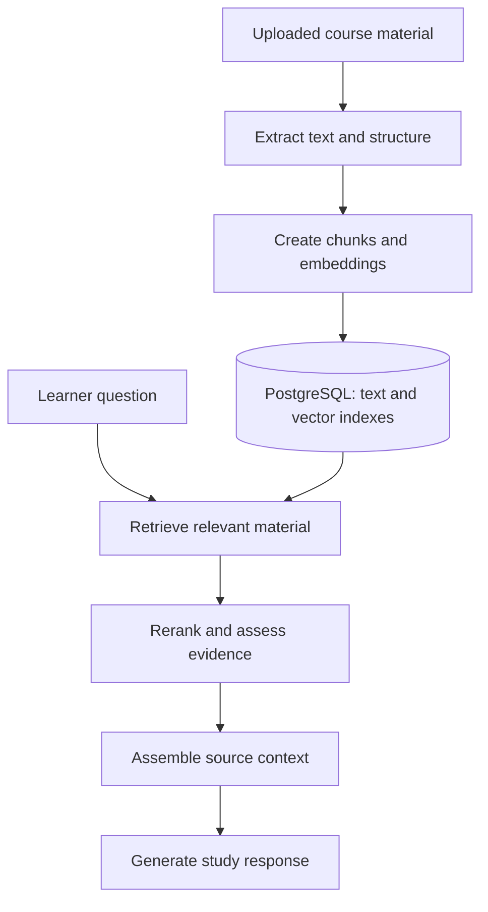
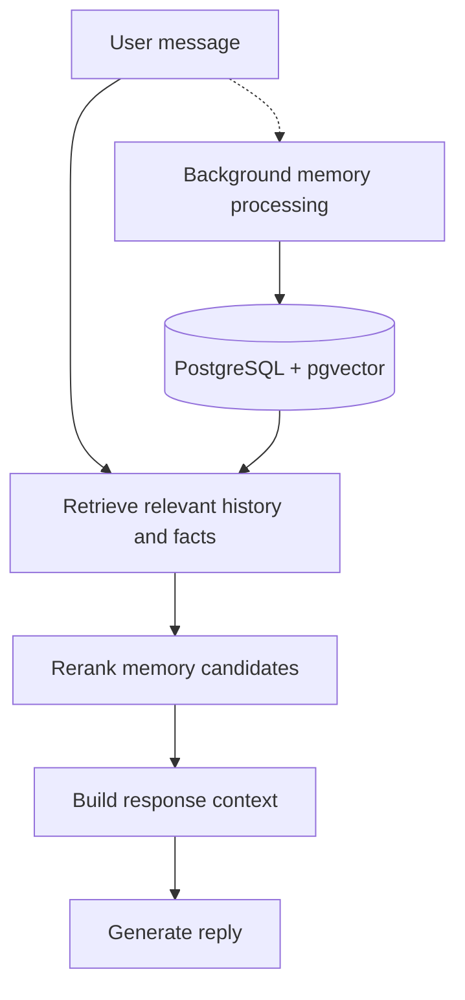
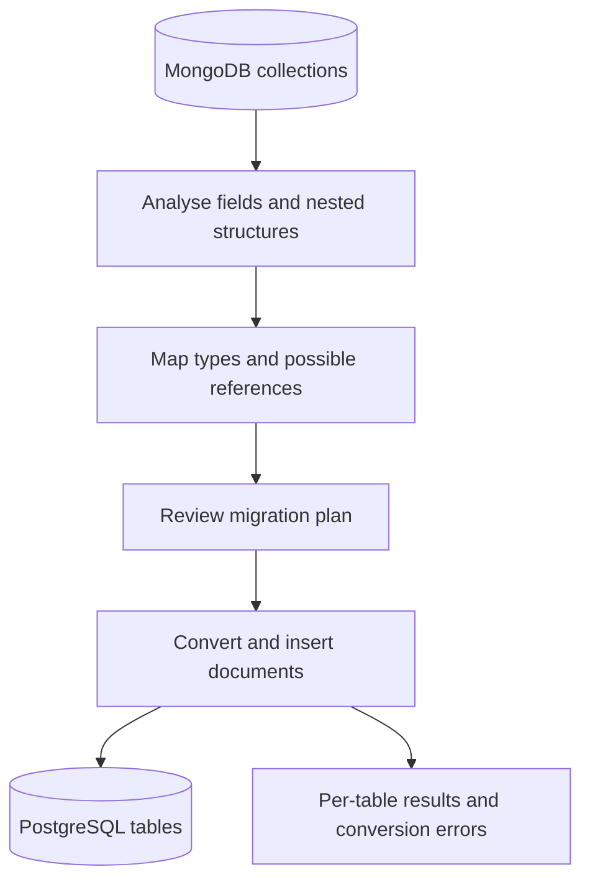

# Naheem Olaide

Software engineer focused on backend systems, AI and developer tools. B.Sc. Computer Engineering student at Obafemi Awolowo University, Nigeria.

[Email](mailto:naheemolaide5@gmail.com) · [LinkedIn](https://linkedin.com/in/naheemolaide) · [X](https://x.com/naheem__x)

Open to software engineering internships for summer 2027.

## Open source

| Project | What it does |
| --- | --- |
| [Repo Doctor](https://github.com/appdever01/repo-doctor) | Rust CLI that checks local setup requirements for Node.js and Python projects, with findings and next steps. |
| [Editlane](https://github.com/appdever01/editlane) | Local CLI and read-only MCP server that gathers relevant source files and nearby tests for coding agents. |
| [React Loading Regions](https://github.com/appdever01/react-loading-regions) | Independent loading states for React, with skeletons and checks that compare loading and loaded layouts. |
| [Coolify Uptime Monitor](https://github.com/appdever01/coolify-uptime-monitor) | Self-hosted monitoring with webhook and email alerts when Coolify resources go down or recover. |
| [OneBucket](https://github.com/appdever01/one-bucket) | One file-upload API for AWS S3, Cloudflare R2, Cloudinary and local storage. |
| [Repair WebMCP](https://github.com/appdever01/repair-webmcp) | Interactive 3D repair guides where people and AI agents work together through WebMCP. |

Issues, feedback and contributions are welcome. Each project's README covers its setup and current scope.

## Products

- [Plud](https://plud.app): Study tools built around uploaded course material, including tutoring, quizzes and flashcards.
- [Binx](https://usebinx.com): AI assistant for WhatsApp and the web. Built conversation memory with PostgreSQL, pgvector and reranking, with background workers for summarisation and memory extraction.
- [DBDock](https://dbdock.xyz): Database backup, restore and migration tools. Built schema analysis, type mapping and storage adapters for the CLI and hosted platform.
- [Bucx](https://bucx.app): USDC payments on Solana, with idempotent transfers and transaction confirmation handling.
- [Clymb](https://useclymb.com): Marketing tools for planning, writing and scheduling campaigns.

## How I solve problems

I start by understanding the user’s problem and tracing the existing workflow. I look for the smallest complete solution, make the tradeoffs clear, and check the failure cases before calling it finished.

Plud: helping learners work with their own material

A study response needs context from the learner’s uploaded material. I separate document preparation from question answering: extract the material, split it into searchable chunks, then retrieve and rerank relevant evidence for the response.

Binx: remembering what matters in a conversation

A longer conversation leaves more history to consider for each reply. I retrieve relevant history and rerank stored facts before building the model’s context. Memory extraction and summarisation run separately from the reply path.

DBDock: moving data between different database models

MongoDB documents and PostgreSQL tables represent data differently. I analyse fields, nested structures and possible references, then produce a mapping that can be reviewed before migration. The conversion reports per-table results and errors instead of treating a partial transfer as success.

## Experience

At Tekcify, I work on backend and AI systems and deploy products with Docker and GitHub Actions to Linux and AWS. My earlier work includes verification workflows and query optimisation at 3rdlink (Vouchmark), and a Flutter payments app at Cardri Technology that processed over $1 million in transaction volume.

## Recognition

| Result | Event | Year |
| --- | --- | --- |
| 1st place, Team Block X, among 1,600+ submissions | GTCO Squad Hackathon 3.0 | 2026 |
| Runner-up | Zenith Bank Zecathon 5.0 | 2025 |
| 1st place | HackerX Africa AI EduHack | 2024 |
| 1st place | BuildCon Hackathon | 2023 |

## Tools I use

  &nbsp;
  &nbsp;
  &nbsp;
  &nbsp;
  &nbsp;
  

**Languages:** TypeScript, JavaScript, Python, SQL and Dart. Rust for Repo Doctor.

**Backend and data:** Node.js, NestJS, PostgreSQL, pgvector, MongoDB and Redis.

**Web and mobile:** React, Next.js and Flutter.

**Infrastructure:** Docker, AWS, Cloudflare R2 and GitHub Actions.
